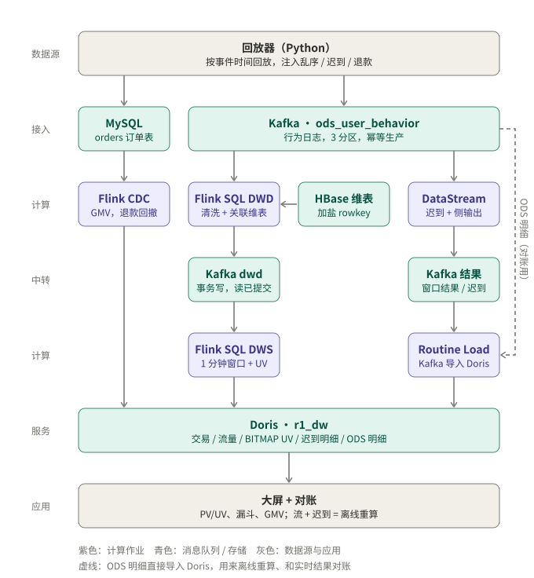
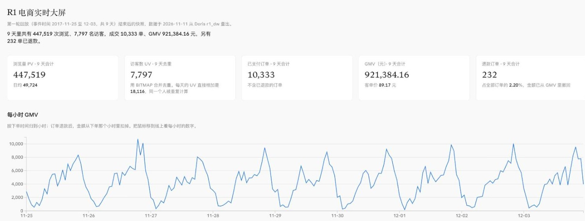

# 电商用户行为实时数仓

在一台 Ubuntu 虚拟机（16GB 内存，ARM64）上，从安装组件开始，完整搭建一条实时数仓链路：
- **数据**：回放器按事件时间回放 9 天、50 万条用户行为，并故意注入乱序和迟到；
- **计算**：Flink SQL 和 DataStream 两套作业；
- **存储**：Kafka、HBase 维表和 Doris；
- **验证**：用三种对账证明结果正确，强杀 TaskManager 后数据不丢、不重复；
- **画像**：从 DWS 沉淀 55 个用户特征，做 RFM + K-Means 分群和 XGBoost 复购预测，标签写回 Doris。

> 版本：Flink 1.20.5、Kafka 4.3.2（KRaft）、HBase 2.6.7、Doris 4.0.8、MySQL 8.0、JDK 17

## 结论

| 验证项 | 结果 |
|---|---|
| SQL 窗口 vs 离线重算（对账 A） | 447,482 条 pv 只差 **62 条（0.014%）**，差的都是按设计丢弃的迟到数据 |
| DataStream 三方对账（对账 B） | 离线 = 实时 + 侧输出，`unexplained = 0` |
| 精确一次 | 回放中途 `kill -9` TaskManager，4 个作业从 checkpoint 自动恢复；GMV 10,333 单、921,384.16 元，**和 MySQL 一分不差** |
| CDC 退款回撤 | 订单退款后，对应分钟的 GMV 被撤回 |
| UV 精确去重 | 分钟 UV 直接相加会多算约 10.7 倍；BITMAP 合并后精确 |
| 端到端延迟 | Kafka → Doris 汇总表约 18 秒，主要来自 30 秒的 checkpoint 间隔 |
| 分区有序 | 故障后追数据时，DWD 各分区的乱序比例和 ODS 完全一致 |

详细数字和分析见 [docs/06.9-R1-第一轮实验结果.md](docs/06.9-R1-第一轮实验结果.md)。

## 架构



<details>
<summary>文字版（带 topic 名和表名）</summary>

```
回放器（Python）──行为日志──→ Kafka ods_user_behavior ──┬──→ Flink SQL：DWD（清洗 + 异步关联 HBase 维表）──→ Kafka dwd_user_behavior
      │                                                 │                                                        │
      │ buy 行为写订单、模拟退款                          │                                         Flink SQL：DWS 流量（1 分钟窗口）
      ↓                                                 │                                                        ↓
MySQL r1_shop.orders ──→ Flink CDC ──→ Flink SQL：DWS 交易（GMV，退款会回撤）──→ Doris dws_trade_1m       Doris dws_traffic_category_1m
                                                        │                                                Doris dws_uv_bitmap_1m（BITMAP）
                                                        │
                                                        ├──→ Java DataStream：Watermark + allowedLateness + 侧输出
                                                        │        ├─ 窗口结果 → Kafka → Routine Load → Doris dws_behavior_1m_stream
                                                        │        └─ 侧输出   → Kafka → Routine Load → Doris dwd_late_events
                                                        │
                                                        └──→ Routine Load → Doris ods_user_behavior（离线重算、对账用）

HBase dim_user / dim_item：维表（加盐 rowkey + 预分区），由 Flink 作业从 CSV 导入
```

</details>

## 大屏



- **截图**是第一轮回放结束后的快照：9 天 447,519 次浏览、7,797 名访客（BITMAP 去重；每天的 UV 直接相加是 18,116）、已支付 10,333 单、GMV 921,384.16 元、退款 232 单。GMV 和直接在 MySQL 里算的一致。
- **实时版**用 Grafana 直连 Doris，每 5 秒刷新，回放时指标和曲线跟着变：运行 [setup/07-grafana.sh](setup/07-grafana.sh)，然后打开 `http://虚拟机IP:3000`。数据源和 12 个面板都预置在 [setup/conf/grafana/](setup/conf/grafana/r1-dashboard.json)。

## 用户画像

回放结束后运行 `bash mvp/bin/profile.sh`（在虚拟机的 `~/r1-realtime-dw` 里是 `bash bin/profile.sh`），约 15 秒跑完：

```
ODS 明细 ──Doris SQL──→ dws_user_behavior_1d（用户 × 天）──→ dws_user_feature（55 个特征）
                                                                  ├──→ RFM + K-Means 分群
MySQL 订单（金额、退款）、用户维表 ─────────────────────────────────┤
                                                                  └──→ XGBoost：未来 3 天是否购买
                                                                            ↓
                                                         ads_user_profile_tag（每个用户一行画像标签）
```

| 项 | 结果（模拟数据） |
|---|---|
| 特征 | 55 个，每个都有中文说明，写在 Doris 列注释里；特征只用截止时间之前的数据 |
| 分群 | 669 个买过的用户；K 由轮廓系数在 3–8 里选出，为 5 群（如「近期超高频超高额」「沉睡中频低额」） |
| 复购模型 | 按时间切分，测试集 AUC **0.910**，PR-AUC 0.663；调参只在训练集内部做 |
| 基线对照 | 只用「行为次数」一个特征的 AUC 也是 **0.911** |

**这些数字只说明链路跑通了。** 模拟数据里，买不买只和活跃度有关，所以模型和单特征基线持平。要得到有意义的结果，需要换真实的 UserBehavior 数据重跑，代码不用改。详见 [docs/06.15-R1用户画像链路.md](docs/06.15-R1用户画像链路.md)。

## 数据血缘与表结构

- **交互式血缘图**：[docs/lineage.html](docs/lineage.html)。18 个节点、89 个字段的表级和字段级血缘：点一张表看上下游，点一个字段看它从哪来、怎么算、影响哪些指标。GitHub 不直接渲染 HTML，下载后用浏览器打开。
- **表结构与数据样例**：[mvp/R1-表结构与数据样例.xlsx](mvp/R1-表结构与数据样例.xlsx)。按分层列出 9 张表和 4 个 topic，带字段说明和真实数据样例。

## 目录

| 路径 | 内容 |
|---|---|
| [`setup/`](setup/README.md) | 环境安装脚本：00–06 依次装基础环境、MySQL、Kafka、HBase、Doris、Flink、Python，带启停脚本和冒烟测试 |
| [`mvp/`](mvp/README.md) | 数仓本身：数据准备、回放器、Flink SQL、Java DataStream 作业、Doris 建表和对账 SQL、运行脚本 |
| [`docs/`](docs/) | 环境方案、每一步的记录、排障过程和实验结果 |

## 怎么跑

1. **准备虚拟机**：按 [docs/00-虚拟机准备.md](docs/00-虚拟机准备.md) 建好 Ubuntu Server 24.04 虚拟机并固定 IP。
2. **装环境**：按 [setup/README.md](setup/README.md) 依次运行 7 个安装脚本，冒烟测试三项都通过即可。
3. **跑数仓**：按 [mvp/README.md](mvp/README.md) 第三节运行 `prepare → setup → start_jobs → replay → check`，再用 `sql/ads_dashboard.sql` 对账。

## 排障记录（每个都有日志证据和修复验证）

| 问题 | 根因 | 记录 |
|---|---|---|
| Lookup Join 一直连不上 ZooKeeper | 连接器内置的 ZooKeeper 3.4 客户端在 JDK 14+ 上解析不了主机名（ZOOKEEPER-3779），给 jar 打了一行补丁 | [06.4](docs/06.4-R1环境排障.md) |
| 故障恢复后实时 UV/PV 掉了 76% | DWD 追数据时打乱了分区顺序：librdkafka（CRC32）和 Java 客户端（murmur2）分区算法不同；另外空闲超时比上游提交间隔短 | [06.6](docs/06.6-R1-分区保序与重跑.md) |
| Doris 实时表 6 分钟不更新，或完全不进数 | 三个问题叠在一起：Doris 4 的自适应批次每批至少 360 秒；事件时间（2017 年）被写成 Kafka 消息时间戳，被保留策略当作过期删掉；Doris 复用了坏掉的 Kafka 消费者 | [06.7](docs/06.7-Doris导入卡住根因.md) |
| HBase 在虚拟机卡顿后退出 | 虚拟机整体停顿 23 秒，超过 ZooKeeper 会话超时（默认 10 秒） | [06.5](docs/06.5-R1-MVP首次运行.md) |

## 还没做的

- 实验 1 峰值吞吐（`replay.sh --speed 0 --max-rate 20000`）、实验 5 维表缓存对吞吐的影响。
- Flume 采集。
- 用真实的 UserBehavior 数据重跑用户画像（现在是模拟数据，复购模型和单特征基线持平）。
- 血缘图和表结构 Excel 还没加上画像的 3 张表。
